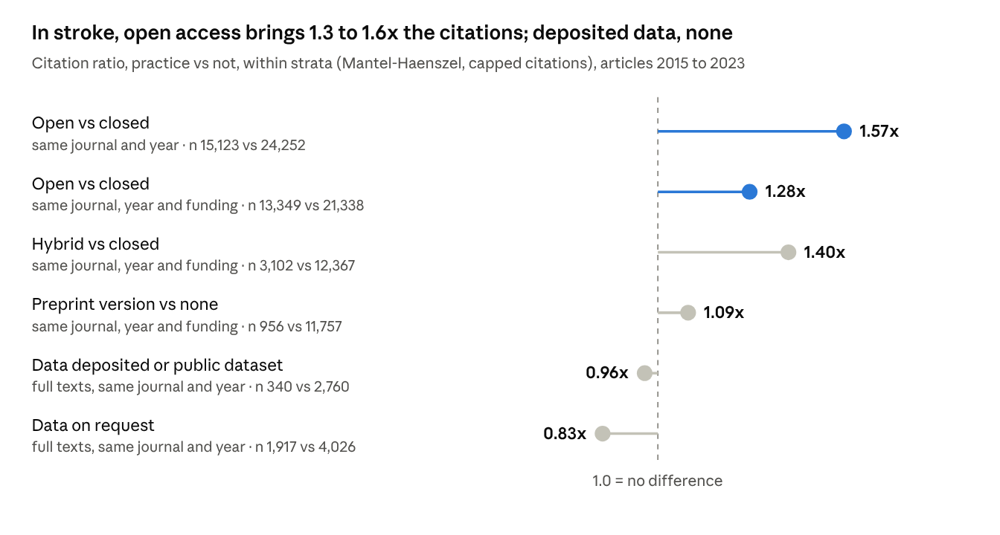

# WSC 2026 talk: reading pack

15 October 2026 · Sebastian Fridman · offline copy of the Claude Doc "WSC 2026 talk: reading pack"

Contents: [Start here](#start-here) · [Reproducibility](#reproducibility-the-crisis-next-door) · [NINDS rt-PA](#ninds-rt-pa-the-data-story) · [Other re-analyses](#other-re-analyses-by-outsiders) · [Readers and citations](#access-readers-and-citations) · [Imaging tools](#access-imaging-tools) · [Value](#value) · [Proposals](#background-for-the-proposals) · [Questions](#questions-to-expect)

## Start here

Eight sources, about two hours in total, cover what you are most likely to be challenged on: the NINDS story, the citation claim, open imaging tools and the cost of "on request". Every number on the new slides traces to one of them or to the sections below.

| # | Source | Why read it | Slide | Time |
| --- | --- | --- | --- | --- |
| 1 | [Dachs 2008, PLoS Med](https://doi.org/10.1371/journal.pmed.0050113) | How the NINDS data were refused, then sold on CD in 2003; the 27 reports by trial authors meanwhile | NINDS rt-PA | 10 min |
| 2 | [Ingall 2004, Stroke](https://doi.org/10.1161/01.STR.0000140891.70547.56) | The independent re-analysis: OR 2.1 after adjustment | NINDS rt-PA | 15 min |
| 3 | [UK MHRA expert group 2015](https://assets.publishing.service.gov.uk/government/uploads/system/uploads/attachment_data/file/448997/Final_conclusions_and_recommendations.pdf), pages 9 to 12 | How a regulator weighed the critics' and the committee's methods | NINDS rt-PA | 15 min |
| 4 | [Lindley, Wardlaw, Sandercock 2005, Lancet Neurol](https://doi.org/10.1016/S1474-4422(05)70044-2) | Why the blood-pressure recommendations from NINDS needed reconsidering | NINDS rt-PA | 10 min |
| 5 | [Davis 2008, BMJ](https://doi.org/10.1136/bmj.a568) | The randomised trial of open access: more downloads, no more citations | Access | 10 min |
| 6 | [de la Rosa 2025, Nat Commun](https://doi.org/10.1038/s41467-025-62373-x) | DeepISLES: three open challenge models in one tool, validated on 1,685 scans | Access | 20 min |
| 7 | [Scutt 2020, BMJ Open](https://pubmed.ncbi.nlm.nih.gov/32912955/) | Bath's group asked 391 vascular and cognitive trials for data: 20% delivered, median 241 days | Value, data statements | 10 min |
| 8 | [Taherifard 2026, BMJ](https://doi.org/10.1136/bmj-2026-100460) | 336 shared trials: 79% reused, 209 papers by outside teams | Value | 10 min |

## Reproducibility: the crisis next door

The four historical numbers measure different things (replication, power, publication bias in animal stroke studies, experience), so present them side by side, never as one failure rate. Ten years on, psychology has rules but practice still lags.

| Source | What it shows | On the slide | Watch out |
| --- | --- | --- | --- |
| [Open Science Collaboration 2015, Science](https://doi.org/10.1126/science.aac4716) | 36% of 100 psychology findings replicated with a significant result; effects about half the size | 36% | Replication in new data, not reanalysis |
| [Button 2013, Nat Rev Neurosci](https://doi.org/10.1038/nrn3475) | Median statistical power of neuroscience studies 21% | 21% | A power estimate, not a failure rate |
| [Sena 2010, PLoS Biol](https://doi.org/10.1371/journal.pbio.1000344) | Of 525 animal stroke publications, only 10 (2%) reported no effect on infarct volume; publication bias explains about a third of reported efficacy (31.3% to 23.8%); about 14% of experiments never published | 10 of 525 | Publication bias, not replication |
| [O'Collins 2006, Ann Neurol](https://doi.org/10.1002/ana.20741) | 1,026 experimental stroke treatments: the 114 used clinically were no more effective in animals than the 912 tested only in animals | Notes | "None translated" is not in the abstract; do not say it |
| [Macleod 2008, Stroke](https://doi.org/10.1161/STROKEAHA.108.515957) | NXY-059 improved infarct volume by 43% in animals, but only 2 of 9 publications reported randomisation, concealment and blinding; SAINT I positive, SAINT II neutral | Notes | |
| [Baker 2016, Nature](https://doi.org/10.1038/533452a) | 70% of 1,576 researchers had failed to reproduce another group's experiment | 70% | A survey of experience |
| SCORE, Nature 2026 (talk/evidence_intro.md) | 55% of 274 social and behavioural science claims replicated; effect r 0.25 to 0.10; data available for 24% of 600 papers | 55% | Social and behavioural sciences, not medicine |
| [Hardwicke 2024, AMPPS](https://doi.org/10.1177/25152459241283477) | 7% of 2022 psychology articles preregistered, 14% shared raw data; 3% and 2% in 2014 to 2017 | 7% and 14% | |
| [Begley & Ellis 2012, Nature](https://doi.org/10.1038/483531a) | Amgen confirmed 6 of 53 landmark preclinical cancer findings | Off the slide; if asked | A company report; the data were never shared |
| [Simmons 2011, Psychol Sci](https://doi.org/10.1177/0956797611417632) | Four routine analysis choices raise a 5% false-positive rate to 61% | Notes | Simulation |
| [John 2012, Psychol Sci](https://doi.org/10.1177/0956797611430953) | 63% of 2,155 psychologists admitted not reporting all their measures | Notes | Self-report |
| [National Academies 2019](https://doi.org/10.17226/25303) | Definitions: reproducibility (same data and code) vs replicability (new data) | Notes | Use these terms if challenged |

If asked about lesion mapping: van den Heuvel 2026 (Nat Neurosci, [doi](https://doi.org/10.1038/s41593-025-02196-7)) re-analysed lesion network mapping with public data only; replies include Zalesky and Cash, Siddiqi and Fox, and Corbetta's group. Present it as a live debate that open data made possible.

## NINDS rt-PA: the data story

Opening the NINDS data did not sink tPA: an independent re-analysis confirmed the benefit (OR 2.1) and found what the papers had not said. The table runs oldest first because it is a story.

| Year | What happened | Source |
| --- | --- | --- |
| 1995 | Two-part trial, 624 patients. Part 1 missed its 24-hour primary outcome; part 2 global OR 1.7 (1.2 to 2.6). Symptomatic haemorrhage 6.4% vs 0.6%; mortality 17% vs 21% (not significant) | [NEJM 1995](https://doi.org/10.1056/NEJM199512143332401) |
| 1995 to 2003 | Critics cite an imbalance: NIHSS 0 to 5 in 42 tPA vs 16 placebo patients. Outside researchers are refused the data, even after a Freedom of Information petition to the FDA; trial authors publish at least 27 reports from the same dataset | [Dachs 2008](https://doi.org/10.1371/journal.pmed.0050113); MHRA 2015 |
| 2002 | BMJ investigation (Lenzer, March); in November: "Controversial stroke trial is under review following BMJ report". NINDS commissions an independent committee | [Lenzer 2002](https://pubmed.ncbi.nlm.nih.gov/12433750/) |
| 2003 | Data released: NTIS CD-ROM, US$79 plus shipping, 100 variables, SAS conversions, no codebook. By 2008 only three outside groups had used it | [Dachs 2008](https://doi.org/10.1371/journal.pmed.0050113) |
| 2004 | Committee: benefit holds after adjustment, OR 2.1 (1.5 to 2.9). New: no time gradient within 3 h detectable; blood-pressure data "too unreliable for inclusion in analysis" (112 patients, 18%, with identical admission and randomisation readings; 22 missing). Committee members had no connection with NINDS, the trial or the manufacturer; it still recommended rigorous BP management | [Ingall 2004](https://doi.org/10.1161/01.STR.0000140891.70547.56); [Hertzberg 2008](https://doi.org/10.1177/1740774508094404) |
| 2005 | Imbalance did not materially affect the result; BP recommendations from NINDS need reconsidering | [Lindley 2005](https://doi.org/10.1016/S1474-4422(05)70044-2) |
| 2007 | Severity-adjusted endpoint confirms benefit (public data) | [Saver & Yafeh 2007](https://doi.org/10.1161/01.STR.0000254580.39297.3c) |
| 2009 | Graphs of all 624 patients: differences "diminish or disappear" on change in NIHSS; calls for larger trials | [Hoffman & Schriger 2009](https://doi.org/10.1016/j.annemergmed.2009.03.019) |
| 2010 | Matched re-analysis: benefit persists, 13 to 23% smaller, mostly in large-vessel occlusion. Graphic re-analysis: tPA patients recover two-thirds of the possible change vs half with placebo | [Mandava 2010](https://doi.org/10.1161/STROKEAHA.109.574103); [Saver 2010](https://doi.org/10.1161/STROKEAHA.110.583807) |
| 2015 | UK regulator's expert group: change-from-baseline is biased against the arm with more mild strokes; randomisation errors had no impact (FDA analysis); half the 0 to 90 min patients were treated at 89 to 90 min, so NINDS cannot test time-is-brain; no regulatory implications | [MHRA 2015](https://assets.publishing.service.gov.uk/government/uploads/system/uploads/attachment_data/file/448997/Final_conclusions_and_recommendations.pdf) |
| 2022 to 2023 | Selection-bias claim (3 of 7 positive results lose significance; all ORs still favour tPA). Eight investigators reply: every error disclosed to FDA, most gave placebo to patients assigned tPA; "All data from the original trial is available from the NINDS" | [Garg 2022](https://doi.org/10.1186/s12874-022-01651-4); [Lyden 2023](https://doi.org/10.1186/s12874-023-02074-5) |
| 2026 | NINDS archive: "data requests will no longer be accepted ... contact the Principal Investigators"; migration expected by end of 2026 | [NINDS page](https://www.ninds.nih.gov/current-research/research-funded-ninds/clinical-research/archived-clinical-research-datasets), checked 15 Oct 2026 |

Two cautions for the room: trial investigators often attend WSC, and the critics' conclusions are not settled science, so describe them as "critics re-analysed the same file". The BMJ 2002 claims about Genentech funding were not verified and stay off the slides.

## Other re-analyses by outsiders

Independent re-analyses are rare because access is rare: of 37 published re-analyses of trial data, only 5 were by fully independent teams, and where data were shared, 14 of 17 trials reproduced. The argument for openness is verification, with occasional correction.

| Case | What was open | What outsiders found | Caveat |
| --- | --- | --- | --- |
| [Cluster failure, Eklund 2016, PNAS](https://doi.org/10.1073/pnas.1602413113) | 499 resting-state scans from the 1000 Functional Connectomes Project | fMRI cluster inference gave false positives up to 70% against a nominal 5%; a 15-year-old AFNI bug | 70% is the worst case; the "40,000 studies" sentence was corrected |
| [ECASS III, Alper 2020, BMJ EBM](https://doi.org/10.1136/bmjebm-2020-111386) | Boehringer data through ClinicalStudyDataRequest.com | Published significance held only under three choices not in the protocol; seven alternatives gave P 0.054 to 0.173 | Contested; guidelines unchanged; authors had argued for re-analysis before. Backup slide at most |
| [Rosiglitazone, Nissen 2007, NEJM](https://doi.org/10.1056/NEJMoa072761) and [Wallach 2020, BMJ](https://doi.org/10.1136/bmj.l7078) | Results GSK had to post after a 2004 settlement; later patient data via CSDR | MI OR 1.43, then FDA and EU restrictions (2010); patient data showed more MIs than published summaries in 26 of 29 trials | FDA lifted restrictions in 2013; size of the risk still debated |
| [Study 329, Le Noury 2015, BMJ](https://doi.org/10.1136/bmj.h4320) | GSK documents and patient data, external team | No efficacy; suicidal or self-injurious behaviour 11/4/2 vs 5/3/1 published | Original paper not retracted; expression of concern 2026 |
| [Tamiflu, Jefferson 2014, BMJ](https://doi.org/10.1136/bmj.g2545) | Clinical study reports from EMA and Roche, about 150,000 pages | Symptoms 16.8 h shorter; no effect on hospital admission | A Roche-funded analysis disagrees (Dobson 2015) |
| [Sato trials, Bolland 2016, Neurology](https://doi.org/10.1212/WNL.0000000000003387) | Published baseline tables only | Fabrication in trials of hemiplegic stroke patients; about 30 retractions incl. JAMA, Neurology, Stroke | Forensics of summaries, not shared data |
| Surgisphere 2020: [Lancet retraction](https://doi.org/10.1016/S0140-6736(20)31324-6), [NEJM retraction](https://doi.org/10.1056/NEJMc2021225) | Nothing | Two COVID papers retracted within weeks because no auditor could see the data; the Lancet then required data-sharing statements | Fabrication never formally adjudicated |
| [Ebrahim 2014, JAMA](https://doi.org/10.1001/jama.2014.9646) | 37 published re-analyses | 13 (35%) changed who or how many to treat; only 5 by independent authors | Mostly the original authors re-analysing |
| [Naudet 2018, BMJ](https://doi.org/10.1136/bmj.k400) | 37 RCTs in journals with full sharing policies | Data obtained for 17 (46%); 14 of 17 fully reproduced | Sharing policies are not sharing |

One more if you want a cardiology example of shared data correcting a paper: in the SPRINT data challenge, a Yale team found the published cardiovascular risk profile was wrong (76%, not 61%, at 15% or more risk) and NEJM corrected it ([Warner 2018](https://doi.org/10.1136/bmjopen-2018-021685)).

## Access: readers and citations

Open work is read more and cited somewhat more; sharing data earns no citations. Say "readers", not "citations": the strongest designs found more downloads and no extra citations.

| Source | Design | Finding | Watch out |
| --- | --- | --- | --- |
| [Davis 2008, BMJ](https://doi.org/10.1136/bmj.a568) | Randomised: 1,619 articles, 11 journals | Full-text downloads +89% (76 to 103%); 59% vs 63% cited at 1 year | Physiology journals |
| [Davis 2011, FASEB J](https://doi.org/10.1096/fj.11-183988) | Randomised: 36 journals | Cited "no more frequently, nor earlier" at 3 years | |
| [Langham-Putrow 2021, PLoS One](https://doi.org/10.1371/journal.pone.0253129) | Systematic review, 134 studies | 47.8% found an open-access advantage, 27.6% none, 23.9% only in subsets | About 98% at high risk of bias |
| [Piwowar 2018, PeerJ](https://doi.org/10.7717/peerj.4375) | 100,000 articles | Open 1.18 vs world average, closed 0.90, gold 0.83 | "+18%" is vs world average, not vs closed |
| [Piwowar & Vision 2013, PeerJ](https://doi.org/10.7717/peerj.175) | 10,555 microarray studies | Shared data +9% (5 to 13%) after many controls | Genomics |
| [Colavizza 2024, PLoS One](https://doi.org/10.1371/journal.pone.0311493) | About 122,000 papers | Data in a repository +4.3%; preprints +20%; code no advantage | Mostly PLOS, where sharing is mandatory |
| [Fu & Hughey 2019, eLife](https://doi.org/10.7554/eLife.52646) | 74,239 bioRxiv-era articles | Preprinted articles 1.36x citations | Biology |
| [Zissette 2024, JAMA Netw Open](https://doi.org/10.1001/jamanetworkopen.2024.24732) | 5,739 articles in 25 clinical journals | Preprints: no difference outside COVID | |

**Our stroke data** (first stroke-specific estimate found). 2015 to 2023 articles, OpenAlex citations, compared within the same journal and year; funded papers are 41% of open and 20% of closed articles. Table: `talk/outputs/tables/stroke_citations_by_open_practice.csv`; code: `citation_outputs` in `scripts/wsc2026_talk_analysis.py`.

Matching on funding halves the open-access advantage; a deposited dataset or an "on request" statement brings no extra citations. Observational: authors may open their stronger work.

## Access: imaging tools

Commercial stroke AI works where hospitals can pay for it; open algorithms exist, but none is regulated or tested in a low- or middle-income country. Frame this as a business-model problem, not a company problem: JLK and Heuron are Korean vendors.

| Theme | Source | Finding |
| --- | --- | --- |
| Benefit | [Martinez-Gutierrez 2023, JAMA Neurol](https://pubmed.ncbi.nlm.nih.gov/37721738/) | Viz.ai stepped-wedge cluster RCT: door-to-groin -11.2 min (-18.2 to -4.2); no mRS difference. PI received Viz grants |
| Benefit | [Nagaratnam 2025, Lancet Digit Health](https://pubmed.ncbi.nlm.nih.gov/41339157/) | Brainomix at 26 English hospitals: thrombectomy 2.3% to 4.6% vs 1.6% to 2.6% elsewhere. Observational, company co-authors |
| Cost | [NICE HTG708, 2024](https://www.nice.org.uk/guidance/htg708) | Licences about GBP 15,000 to 30,000 a year per centre (manufacturers' estimates) |
| Cost | US CMS final rule FY2021 (85 FR 58636) | Add-on payment for Viz.ai ContaCT up to $1,040 per case |
| Cost, Korea | HIRA AI guideline 2023; press (Hitnews, Sep 2024) | Stroke AI not covered by national insurance; non-contrast CT LVO screening capped at KRW 18,100 per scan (press only) |
| Dependence | [Albers 2018, NEJM (DEFUSE 3)](https://pubmed.ncbi.nlm.nih.gov/29364767/) | Core and penumbra "calculated with the use of RAPID software"; DAWN used the same. FDA K182130 (2018) then cleared RAPID for thrombectomy selection |
| Disagreement | [Mallon 2022, J Stroke Cerebrovasc Dis](https://pubmed.ncbi.nlm.nih.gov/35994882/) | Brainomix vs RapidAI, same 54 patients: thrombectomy eligibility discordant in 15% |
| Disagreement | [Koopman 2019, JNIS](https://pubmed.ncbi.nlm.nih.gov/31203208/) | Same scans: median core 50 mL (Philips), 41 mL (Siemens), 11 mL (RAPID) |
| Agreement | [Pisani 2023, Ann Neurol](https://pubmed.ncbi.nlm.nih.gov/37584452/) | Newer packages mostly agree: RAPID vs Viz core rho 0.77 |
| Real world | [Kunst 2024, JACR](https://pubmed.ncbi.nlm.nih.gov/37196818/) | LVO triage sensitivity 97% (manufacturer) fell to 85% for ICA/M1, 69% with M2 |
| Simpler imaging | [MR CLEAN-LATE 2023, Lancet](https://pubmed.ncbi.nlm.nih.gov/37003289/); [CLEAR 2022, JAMA Neurol](https://pubmed.ncbi.nlm.nih.gov/34747975/) | Late-window selection by CTA collaterals works; NCCT vs CTP selection, no difference in 90-day mRS |
| Access gap | [MT-GLASS, Asif 2023, Circulation](https://pubmed.ncbi.nlm.nih.gov/36883458/) | Median thrombectomy access 2.79% of LVO patients; none in 7 countries; 88% lower in low-income countries |
| Access gap | [Hricak 2021, Lancet Oncol](https://pubmed.ncbi.nlm.nih.gov/33676609/) | One CT scanner per 25,000 people (high income) vs 1.7 million (low income) |
| Access gap, Korea | [Lee 2026, BMC Health Serv Res](https://pubmed.ncbi.nlm.nih.gov/41787379/) | 22.5% of ischaemic stroke patients (2021) lived in a district without a thrombectomy centre |
| Open | [de la Rosa 2025, Nat Commun](https://doi.org/10.1038/s41467-025-62373-x) | DeepISLES, Apache-2.0, 1,685 external scans, preferred to manual masks. MRI only, research use |
| Open | [Brugnara 2023, Nat Commun](https://pubmed.ncbi.nlm.nih.gov/37582829/) | Academic LVO detector on an open framework beat two cleared products by 25 to 45% in sensitivity. Partly open |
| Gap | ISLES'24 (preprint, arXiv 2408.10966) | Final infarct from acute CT and perfusion: best Dice 0.285. No open CTP or LVO tool has peer-reviewed validation |
| Limits | EU MDR Article 5(5) | An in-house device cannot be passed to another hospital without a legal manufacturer |

## Value

Shared data multiply what public money buys; closed data cost time and follow-on research. The waste estimate is the softest number here, so call it an estimate.

| Source | Finding | Slide | Watch out |
| --- | --- | --- | --- |
| [Chalmers & Glasziou 2009, Lancet](https://doi.org/10.1016/S0140-6736(09)60329-9); [their 2016 BMJ blog](https://blogs.bmj.com/bmj/2016/01/14/paul-glasziou-and-iain-chalmers-is-85-of-health-research-really-wasted/) | 85% of health research investment estimated wasted: about half lost at each of design, publication and reporting | 85% | An estimate built from stage losses; verified only through the authors' blog |
| [Macleod 2014, Lancet](https://doi.org/10.1016/S0140-6736(13)62329-6) | Opened the series "Research: increasing value, reducing waste"; authors include Macleod and Al-Shahi Salman (Edinburgh) and Dirnagl (Berlin) | Notes | A stroke hook, not a number |
| [Taherifard 2026, BMJ](https://doi.org/10.1136/bmj-2026-100460) | 336 J&J trials shared via YODA: 265 (79%) reused, 1,167 papers, 209 by outside teams; outside share passes half by year 11 | 209 | Outside papers were cited less and less often in guidelines |
| [Milham 2018, Nat Commun](https://doi.org/10.1038/s41467-018-04976-1) | Shared neuroimaging data used in 913 papers by authors in 50 countries; collecting them again would cost $893 million to $1.71 billion | $0.9 to 1.7B | Cost per subject assumed, $1,000 to $10,000 |
| [Williams 2013, J Polit Econ](https://doi.org/10.1086/669706) ([NBER version](https://www.nber.org/papers/w16213)) | Genes held under Celera's licence for up to two years: 20 to 30% less follow-on research and product development | 20 to 30% | Genomics, not clinical trials |
| [Scutt 2020, BMJ Open](https://pubmed.ncbi.nlm.nih.gov/32912955/) | Of 391 vascular and cognitive trials asked for data, 78 (20%) delivered; median 241 days | Notes, data statements | The closest "on request" evidence to stroke |

## Background for the proposals

Rules alone produced statements, not data; incentives and infrastructure are what moved practice elsewhere. Most toolkit pieces already exist, so the ask to WSO is stewardship, not invention.

| Proposal | Source | Finding |
| --- | --- | --- |
| Task force | [Gabelica 2022, J Clin Epidemiol](https://www.jclinepi.com/article/S0895-4356(22)00141-X/abstract) | Of 1,792 authors promising data "on request", 123 (6.8%) shared |
| Task force | [Danchev 2021, JAMA Netw Open](https://jamanetwork.com/journals/jamanetworkopen/fullarticle/2775667) | Of 334 JAMA, Lancet and NEJM RCTs declaring sharing, 2 (0.5%) had downloadable data |
| Task force | [Bergeat 2022, JAMA Netw Open](https://jamanetwork.com/journals/jamanetworkopen/fullarticle/2792858) | ICMJE statement rule in surgical trials: data obtainable for 3.1% before and 3.1% after |
| Task force | [Scheel 2021, AMPPS](https://doi.org/10.1177/25152459211007467); [Soderberg 2021, Nat Hum Behav](https://www.nature.com/articles/s41562-021-01142-4) | Registered Reports: 44% positive results vs 96%; rated higher on rigour, equal on novelty |
| Task force | ICMJE ([NEJM 2017](https://www.nejm.org/doi/full/10.1056/NEJMe1705439)) | Data-sharing statements required since July 2018; the 2016 draft mandating patient-data release within 6 months was dropped |
| Task force | Evidence brief (talk/evidence_brief.md) | No WSO or ESO position statement on open science was found; no stroke journal offers Registered Reports |
| Toolkits | [IST-3 data, Edinburgh DataShare](https://doi.org/10.7488/ds/1350) | Individual patient data open since January 2021, no application needed: the stroke model to cite |
| Toolkits | [VISTA](https://www.virtualtrialsarchives.org/vista/) | Its rules exclude re-analysis of treatment effects and promise contributors "no risk of re-analysis": not a model for open trial data |
| Toolkits | MR CLEAN Registry (evidence brief) | Patient data cannot be shared under Dutch law because consent for sharing was not obtained: consent wording belongs in the kit |
| Toolkits | [NINDS stroke common data elements, Saver 2012](https://pubmed.ncbi.nlm.nih.gov/22308239/); [utility-weighted mRS, 2015](https://pubmed.ncbi.nlm.nih.gov/26138130/) | Free standard data elements; published utility weights (1.0 / 0.91 / 0.76 / 0.65 / 0.33 / 0 / 0) |
| Toolkits | DeepISLES, nnU-Net, BIDS | Open imaging pieces that exist today (see Access: imaging tools) |
| Prize | [Kidwell 2016, PLoS Biol](https://doi.org/10.1371/journal.pbio.1002456); [Rowhani-Farid 2020](https://pubmed.ncbi.nlm.nih.gov/32269804/) | Badges: Psychological Science open data from under 3% to 39%; the only medical RCT, OR 0.9 |
| Prize | [Rice 2020, BMJ](https://pubmed.ncbi.nlm.nih.gov/32586791/) | 0 of 92 biomedical promotion guidelines mention data sharing, registration or open access |
| Prize | Einstein Foundation Award (evidence brief) | EUR 500,000 a year since 2021 for promoting quality in research: the model for a WSO prize |
| Prize | [Cobey 2024, Open Heart](https://doi.org/10.1136/openhrt-2023-002433) | Cardiology researchers (n = 198) named funding as the most essential incentive |

## Questions to expect

Most hard questions are about method limits or about tPA; answer the limit first, then the number.

| Question | Short answer | Where |
| --- | --- | --- |
| Did the NINDS re-analysis show tPA does not work? | No. The independent committee found the benefit held after adjustment (OR 2.1), and the UK regulator saw no regulatory implications. Critics re-analysed the same file; that debate was possible only because the data were released | NINDS section |
| Is your corpus from PubMed? | No: an OpenAlex title search, journal articles and reviews with a DOI. A wider title-and-abstract search for 2024 gave 37,878 vs 15,602 articles and the same open-access rate, 75.5% vs 75.2% | talk/outputs/tables/corpus_sensitivity_2024.csv |
| Abstracts undercount data and code sharing | Yes, so abstract rates are lower bounds. That is why we read 16,362 full texts: GitHub appears in 1.3% of full texts vs 0.07% of abstracts | Method, Data and code slides |
| The full-text audit only covers open-access articles | Yes, so its rates are optimistic for stroke overall; up to 1,500 per year, each year weighted the same | Method slide notes |
| Will sharing get me more citations? | Open access: about 1.6x in the same journal and year, 1.3x at equal funding. Deposited data: no difference. The randomised trial found more readers, not more citations | Access: readers |
| Privacy and consent stop us sharing | Controlled-access platforms exist (Vivli, YODA); consent wording is the fix, as MR CLEAN Registry shows; IST-3 shares patient data openly | Background for the proposals |
| Commercial imaging AI is regulated and works | Agreed: a cluster RCT and English data show benefit. The gap is cost and access, and that no open tool is yet regulated or validated where most strokes happen | Access: imaging tools |
| Is the commitment index a quality ranking? | No. A descriptive mean of deposit, GitHub and registration rates in the full text, relative to the stroke average; small counts move the order | Commitment slide notes |
| Why is neuroscience ahead on code and preprints? | Partly its title term "neural", about 45% of that corpus, also catches machine-learning papers | Method slide notes |
| Who pays for the toolkits and the prize? | The position statement, retiring "on request" and promotion criteria cost nothing. Registered Reports, the prize and the toolkits need money; most tools already exist | Proposals slide |
| What about industry trials? | Platforms work: 79% of 336 J&J trials shared via YODA were reused, 209 papers by outside teams | Value |
